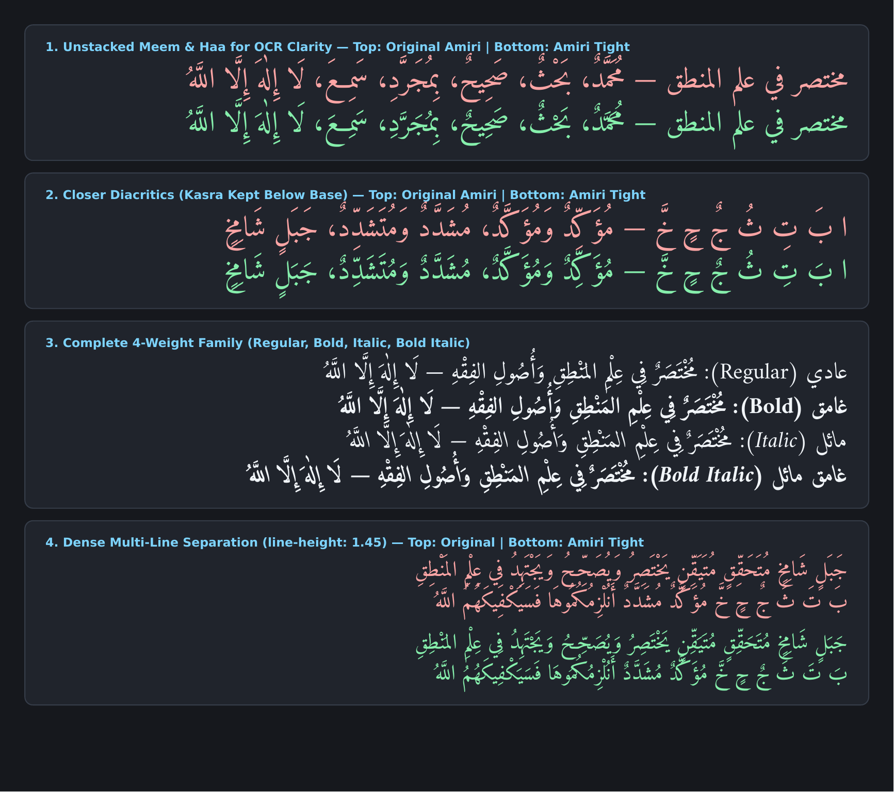

# Amiri Tight (أميري تايت)

نسخة خفيفة ومطوّرة من خط **[أميري (Amiri v1.003)](https://github.com/aliftype/amiri)** مخصّصة للغة العربية، ومصمَّمة لتكون أكثر ملاءمةً **للقراءة الطويلة، والطباعة الورقية، وبرامج التعرّف الضوئي على الحروف (OCR)**، مع الحفاظ الكامل على جماليات خط النسخ الأصيل.



## أبرز التعديلات عن خط Amiri الأصلي

1. **تقريب علامات التشكيل من الحروف (GPOS Mark Positioning):**
   * خفض نقاط الارتكاز العلوية فوق الحروف المنخفضة (`ب، ت، ث، ج، ح، خ، س، م...`) اعتمادًا على الارتفاع المحلي الفعلي لكل حرف بدل الارتفاع الموحّد المرتفع (`Y = 801`)، مما يمنع تداخل التشكيل بين الأسطر.
   * رفع نقاط الارتكاز السفلية مع الحفاظ على مسافة أمان تمنع ملامسة النقاط السفلية، والإبقاء على تموضع الكسرة داخل بطن الحاء والخاء كما هو.
2. **إبقاء الكسرة تحت الحرف (وليس تحت الشدّة):**
   * حفاظًا على وضوح التمييز بين الكسرة والفتحة (مثل `مُؤَكِّدٌ` و`مُؤَكَّدٌ`)، تبقى الكسرة افتراضيًا تحت الحرف الأساسي، مع بقاء خيار `ss05` متاحًا لمن يرغب بتفعيله يدويًا.
3. **فكّ التراكبات العمودية المربكة للـ OCR (GSUB `rlig`):**
   * إظهار حرف الميم أفقيًا وبوضوح في تراكيب مثل **«المنطق»** و**«علم»** و**«بمجرد»** و**«سمع»** بدل إخفائها تحت اللام أو الباء أو السين.
   * فكّ التراكبات العمودية فوق الحاء والخاء والجيم (مثل **«مختصر»** و**«محمد»** و**«بحث»** و**«صحيح»**)، مع الإبقاء الكامل على `لا` و`لله` والاتصال السلس (`curs`) والتقنين (`kern`).
4. **تخفيف الحجم للغة العربية فقط (تقليص 73%):**
   * حذف محارف اللغات غير العربية (الأردية والفارسية والسندية والروهينجيا والرموز الرياضية) مع الإبقاء الكامل على العربية والرموز القرآنية (`﴿ ﴾`، `ﷺ`، `ﷻ`) واللاتينية الأساسية (الإنجليزية والفرنسية والأرقام)، ليصبح حجم `AmiriTight-Regular.ttf` نحو `163 KB` بدل `606 KB`، ونسخة الويب `WOFF2` نحو `72 KB`.
5. **توحيد تباعد الأسطر عبر الأنظمة (`USE_TYPO_METRICS`):**
   * ضبط `OS/2` و`hhea` وتقليص `usWinAscent/usWinDescent` لضمان تطابق عدد الأسطر والصفحات بين Linux (LibreOffice) وWindows (Word) وmacOS.

## محتويات المستودع

* `fonts/ttf/`: ملفات الخطوط لسطح المكتب والطباعة (`Regular`, `Bold`, `Italic`, `BoldItalic`).
* `fonts/woff2/`: نسخ ويب خفيفة مضغوطة بصيغة `WOFF2`.
* `scripts/build_amiri_tight.py`: سكربت البناء (`fontTools`) — يدعم خيار `--full` إذا أردت بناء نسخة بكل اللغات.
* `.github/workflows/build.yml`: سير عمل GitHub Actions تلقائي لبناء الخط وإصدار حزم Releases عند إنشاء وسم (`v*`).
* `assets/comparison.png`: مقارنة بصرية بين الخط الأصلي والمعدّل.
* `OFL.txt` و`AUTHORS.txt`: رخصة الخط المفتوح ونسبة الحقوق للمطوّرين الأصليين.

## التثبيت

### Linux
```bash
mkdir -p ~/.local/share/fonts/AmiriTight
cp fonts/ttf/*.ttf ~/.local/share/fonts/AmiriTight/
fc-cache -fv
```

### Windows و macOS
حدّد ملفات `.ttf` داخل `fonts/ttf/` ثم اختر **Install** (تثبيت).

## البناء والإصدار التلقائي عبر GitHub Actions
عند دفع وسم إصدار جديد مثل:
```bash
git tag v1.0.0
git push origin v1.0.0
```
يقوم GitHub Actions تلقائيًا بتحميل أميري `1.003`، وتشغيل سكربت البناء، ونشر ملف `AmiriTight-v1.0.0.zip` في صفحة **Releases**.

## الرخصة والحقوق
مشتق من خط **[Amiri](https://github.com/aliftype/amiri)** (تطوير خالد حسني ومشروع حروف ألف)، ومرخّص بموجب رخصة **[SIL Open Font License 1.1](OFL.txt)**.
